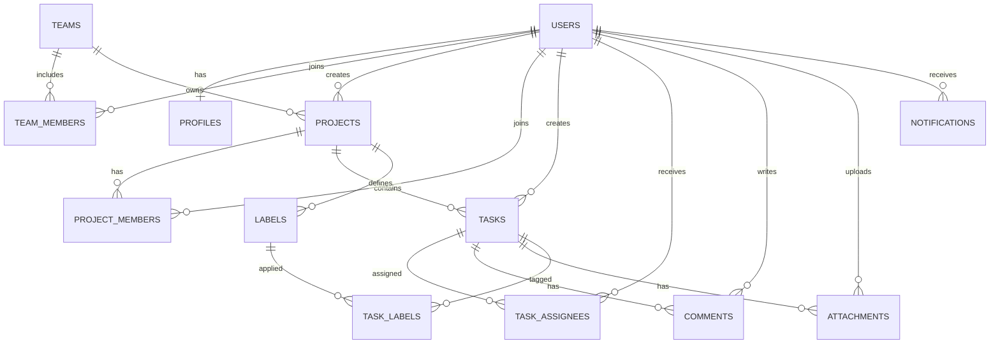

# Entity Relationship Diagram

## Proposed logical ERD

All entities and relationships below are **proposed**; no database tables currently exist in the inspected project. Column-level details and constraints are in [database design](database-design.md).

## Relationship notes

- A team may contain multiple users and projects; `team_members` provides the many-to-many relationship and scoped role.
- A project belongs to one team. `project_members` is an explicit access roster in the current proposal; product must decide whether team membership alone grants project access.
- A task belongs to one project and may have multiple assignees through `task_assignees`.
- Labels are project-scoped and applied through `task_labels`; the API/database strategy must prevent cross-project label assignment.
- Comments, attachments, and notifications are scoped to their parent task or recipient. Authorization follows the parent resource, not just possession of an identifier.
- Admin is represented by a global user role; Project Manager and Team Member are scoped roles on `team_members`.

## Integrity invariants to test

1. Every task's project belongs to exactly one team.
2. Each project member and task assignee is eligible under the approved team/project access policy.
3. Every applied label belongs to the task's project.
4. Removing membership immediately removes access without destroying required historical attribution.
5. Notification recipient and task access are independently checked.
