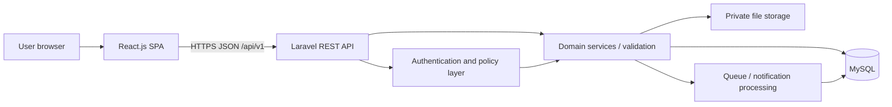

# System Architecture

## Status

This is the proposed target architecture. The workspace inspection found no application code, API routes, deployment manifests, or runtime configuration; the diagram is not evidence of an existing implementation.

## Logical architecture

The queue is a proposed implementation detail; a queue driver and delivery guarantees must be selected. Initial notifications may be processed synchronously if volume and latency permit, but email/push delivery is not assumed.

## Responsibilities

- **React SPA:** presentation, client-side form feedback, routing, and API calls. It is not a trusted security boundary.
- **Laravel API:** identity/session management, validation, authorization policies, business rules, serialization, transactions, and operational logging.
- **MySQL:** durable relational records and referential integrity.
- **Private file store:** attachment bytes; relational metadata lives in MySQL. Serve downloads through an authorized API or short-lived signed URLs after access checks.
- **Git/GitHub:** source history and review workflow. Secrets and environment-specific data are excluded from source control.

## API and authentication proposal

Use JSON REST endpoints under `/api/v1`. For a first-party React SPA, evaluate Laravel Sanctum's stateful cookie/session authentication, CSRF protection, secure `HttpOnly` cookies, credentialed CORS allow-listing, and same-site deployment where feasible. If frontend/backend origins differ, configure trusted stateful domains and CSRF flow explicitly. Do not store long-lived bearer credentials in browser local storage. A separate token strategy for non-browser clients requires a decision and threat review.

All requests must be authenticated as applicable; Laravel policies/services enforce roles and resource membership. API response contracts are in [API response formats](../04-api/api-response-formats.md).

## Data and trust boundaries

1. Browser input is untrusted; validate shape, limits, and allowed values at the API boundary.
2. A client-supplied user/resource ID never proves access.
3. File uploads are untrusted; enforce allow-lists, size limits, safe generated object keys, and malware scanning decision.
4. Store credentials as strong password hashes; do not log secrets.
5. Keep MySQL and private object storage off public networks where practical; restrict service credentials by least privilege.

## Deployment topology (proposed)

Separate frontend static hosting and backend application hosting may be used, with TLS termination and restricted CORS. Production secrets are injected through a secrets manager/environment configuration. Use private managed MySQL and private attachment storage. Add health checks, structured logs, backup monitoring, and alerting. Concrete topology, regions, providers, and scaling are open decisions in [deployment plan](../07-deployment/deployment-plan.md).

## Key architecture decisions to record

- Supported Laravel/PHP/React/Node/MySQL versions and React build tool.
- Stateful cookie/session versus alternative API authentication.
- Same-origin proxy versus cross-origin deployment and CORS policy.
- Queue driver and notification delivery model.
- File storage provider, malware scanning, retention, and download strategy.
- API pagination convention and concurrency control for updates.
