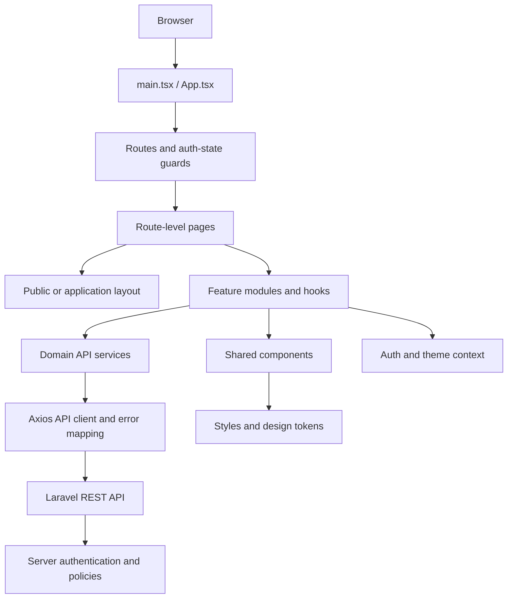

# ManageTask — Frontend Architecture

## Status and constraints

This is a proposed design for a React + Vite single-page application. The inspected `frontend/` folder contains no source files, package manifest, or Vite configuration, so the tree below is a target proposal, not a description of existing code. Phase 1 changes documentation only: do not scaffold, install packages, or implement components until approved.

## Architecture goals

- Keep route composition, shared UI, domain features, and transport concerns separate.
- Make dependencies flow inward from pages/features to shared modules; avoid circular imports.
- Centralize API transport and error normalization rather than calling Axios from arbitrary components.
- Make components easy to test and accessible by default.
- Start with a small number of clear boundaries; split further only when real complexity appears.

## Proposed folder tree

```text
frontend/
├── index.html
├── package.json                  # created only after approval
├── vite.config.ts                # created only after approval
├── tsconfig.json                 # TypeScript recommended
├── .env.example                  # names/placeholders only; no secrets
└── src/
    ├── main.tsx                  # React root and global providers
    ├── App.tsx                   # top-level route/layout composition
    ├── assets/                   # images, fonts, static illustrations
    ├── components/
    │   ├── ui/                   # Button, Input, Modal, Dropdown, Loading, etc.
    │   ├── navigation/           # Sidebar, Navbar, breadcrumbs
    │   └── data-display/         # generic cards, badges, tables, empty states
    ├── pages/                    # route-level screens; compose features/layouts
    │   ├── auth/
    │   ├── dashboard/
    │   ├── projects/
    │   ├── tasks/
    │   ├── calendar/
    │   ├── team/
    │   ├── profile/
    │   ├── settings/
    │   └── notifications/
    ├── layouts/                  # public/authenticated/admin page frames
    ├── features/                 # domain modules and feature-specific UI/hooks
    │   ├── auth/
    │   ├── projects/
    │   ├── tasks/
    │   ├── teams/
    │   ├── calendar/
    │   ├── notifications/
    │   └── profile/
    ├── hooks/                    # small cross-feature reusable hooks
    ├── services/                 # domain API functions using the shared client
    ├── api/                      # Axios client, API error mapping, shared contracts
    ├── context/                  # AuthProvider and ThemeProvider only as needed
    ├── routes/                   # route definitions, guards, not-found behavior
    ├── utils/                    # pure formatting, date, and mapping helpers
    ├── constants/                # route paths and stable UI-wide constants
    ├── styles/                   # Tailwind entry, base styles, CSS variables/tokens
    └── types/                    # app-wide types; feature-only types stay local
```

This layout intentionally avoids a separate state-management framework, repository layer, or monorepo structure before requirements demand them. Feature-local folders may contain components/hooks/types for that feature; use shared folders only when code is genuinely reused.

## Folder responsibilities

| Folder | Responsibility and boundary |
|---|---|
| `components/` | Generic, reusable interface pieces with minimal product-specific behavior. Feature-specific cards stay in their feature folder until reuse is demonstrated. |
| `pages/` | Route entry points that select data and compose layouts/features. Keep business logic and large UI details out of page files. |
| `layouts/` | Structural page frames (public/authenticated) and shared navigation slots; should not own domain data rules. |
| `features/` | Cohesive product capabilities: feature components, hooks, and local types. Cross-feature dependencies should be explicit and limited. |
| `hooks/` | Cross-cutting reusable React hooks (for example media query or debounced input). Prefer feature-local hooks for domain behavior. |
| `services/` | Domain operations such as `projectsService.list()` and `tasksService.update()`; invoke the API client and return typed data. No UI state. |
| `api/` | Axios instance, base URL/credentials/CSRF defaults, shared API types, and normalized error handling. Never expose raw Axios usage throughout the UI. |
| `context/` | Small app-wide state such as current authentication status and theme preference. Avoid using context for high-churn server data. |
| `routes/` | URL definitions, route metadata, public/protected wrappers, and fallback route. Route guards improve UX, not authorization. |
| `utils/` | Pure helpers for dates, labels, and safe display formatting; no network or React component state. |
| `constants/` | Stable route names, supported UI display constants, and non-secret settings. API-controlled task values should not be duplicated as an authoritative rule. |
| `assets/` | Static images, icons not available through Lucide, and local fonts where licensing permits. |
| `styles/` | Tailwind setup, CSS reset/base styles, design tokens, and theme variables. |
| `types/` | Shared frontend contracts only. Domain-specific types should live with their feature until used across domains. |

## Module relationships and request flow

1. `main.tsx` mounts `App.tsx` and only required providers.
2. `routes/` maps URLs to `pages/`; public routes use the public layout, and authenticated routes use the app layout and an authentication-state guard.
3. A page composes feature UI. Feature hooks manage view-level request state and call domain functions in `services/`.
4. A domain service calls the shared `api/` client and shapes the result for its feature if needed.
5. The client sends requests to Laravel and normalizes transport/API errors. Laravel policies remain authoritative for authentication and resource access.
6. Shared components render the resulting data and accessible pending, empty, success, and failure states.



## Route organization proposal

Use named route constants instead of scattering literal paths. Suggested paths:

- Public: `/login`, `/register`.
- Authenticated: `/dashboard`, `/projects`, `/projects/:projectId`, `/tasks`, `/board`, `/calendar`, `/team`, `/profile`, `/settings`, `/notifications`.
- Fallback: not-found page; unauthenticated access redirects to login while preserving a safe internal return path.

Confirm route naming and role-based visibility with product owners. Do not infer access from hidden links alone.

## Backend integration preparation

### Authentication and token/session handling

The existing backend proposal favors Laravel Sanctum stateful session authentication for the first-party browser SPA. Confirm the deployment origin, Sanctum domains, CORS allow-list, cookie SameSite/Secure settings, and CSRF bootstrap flow with the backend team. Keep session credentials in secure HttpOnly cookies; do not put long-lived bearer tokens in local storage or session storage. The UI may keep a minimal current-user/auth status in `AuthProvider`; it must not treat a client role as proof of permission.

### API client and services

- Configure one Axios instance with a base URL from a public environment variable, JSON `Accept` defaults, credentials enabled as required, and CSRF behavior aligned with Sanctum.
- Do not hard-code secrets or environment-specific API URLs in source.
- Put endpoint-specific methods in domain services (`auth`, `projects`, `tasks`, `teams`, `notifications`, `profile`). Keep UI components unaware of endpoint URLs.
- Agree response envelopes, pagination, date conventions, and validation error format with the existing [API proposal](04-api/api-overview.md) before implementation.

### Protected routes and failures

A route guard should wait until the current auth state has been checked, then render, redirect, or show an error. It improves navigation only; Laravel must authorize every API request. Normalize 401 (session expired/sign-in required), 403 (not permitted), 404, 422 (field validation), 429, and network/5xx failures into actionable UI states without displaying server internals. Preserve form values on recoverable failures.

### Data fetching

Begin with feature hooks that own request lifecycle and rely on API pagination/filtering. Avoid duplicating server state in global context. Use cancellation/ignore stale responses when changing routes or filters. If server-state caching/invalidation becomes materially complex, evaluate a query-cache library in a later phase rather than adding one preemptively.

## Quality boundaries

- UI can validate for usability; server validation and authorization are the source of truth.
- Use stable keys and semantic controls; provide keyboard focus, labels, and announced async feedback.
- Test services with mocked transport and test route/page states independently.
- Do not assume endpoints exist until the Laravel team implements and verifies them.

## Related documents

[Project overview](PROJECT_OVERVIEW.md) · [Pages](PAGES_SPECIFICATION.md) · [Components](COMPONENTS_SPECIFICATION.md) · [Design system](DESIGN_SYSTEM.md) · [Technology stack](TECH_STACK.md)
